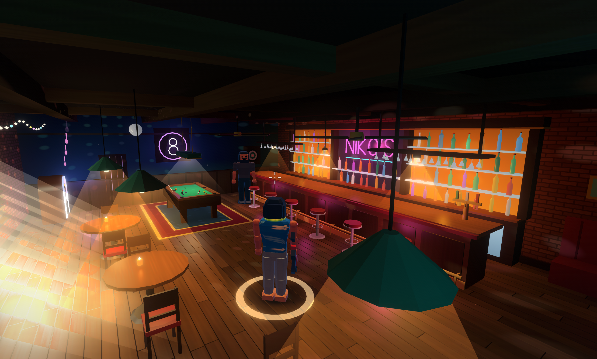
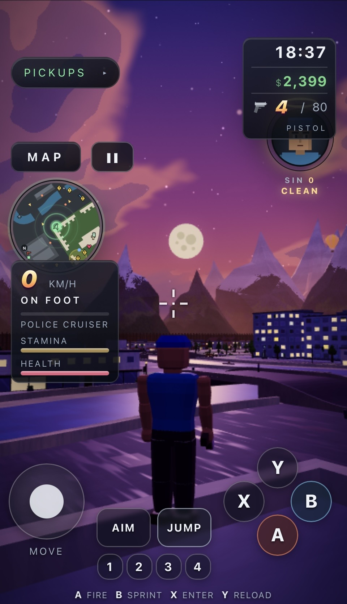

# Sharktown

**▶ Play: https://wolfatthegate.github.io/sharktown/**

A low-poly open-world driving and action game that runs in your browser. There's nothing to install and no sign-up.

Drive, walk and fly through three cities: **Sharktown**, **Santa Fe** and **Prague**. Travel between them by bus or plane, under a sky that turns from day to night.

- **Story:** step off the bus with one bag and a pistol. People around the city offer you jobs: deliver pizza, drive a fare, defuse a bomb, escape a zombie outbreak, break a man out of jail, pull a heist, then go further, to a land of giants and a land of little people. Your progress saves in the browser, so you can pick it up later.
- **Multiplayer:** host a room and send friends the link or the code.

Earn money on the streets and spend it at the gun shop, the clothing shop and the mechanic. Keep out of the police's way, listen to the radio in any car you take, and stay indoors after sundown. It works with keyboard and mouse on a desktop, and with an on-screen pad on a phone.

The game is in beta: things will break, and saves may be reset.

<table>
  <tr>
    <td width="70%"></td>
    <td width="30%"></td>
  </tr>
  <tr>
    <td align="center"><b>Desktop</b>: keyboard and mouse</td>
    <td align="center"><b>Phone</b>: on-screen pad</td>
  </tr>
</table>

## Contributors

<table>
  <tr>
    <td align="center"><a href="https://github.com/wolfatthegate"> <b>WolfWalker</b></a> @wolfatthegate</td>
    <td align="center"><a href="https://github.com/boba-hub"> <b>boba-hub</b></a> @boba-hub</td>
  </tr>
</table>

---

This repository holds **only the compiled game**. It's generated and force-pushed by CI from a private source repository; nothing here is edited by hand, and any commit made directly to it is overwritten on the next deploy.

Copyright © 2026 WolfAtTheGate LLC and contributors. All rights reserved. See [LICENSE](LICENSE).
